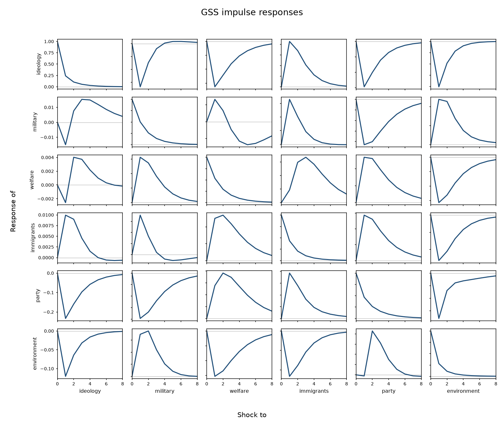

# attitudedyn

R package for the dynamic ordered-probit model of ordinal panel attitudes in Nepaul and Stern (2026, *Political Analysis*). The likelihood is a GHK simulated likelihood. The numerical work lives in a dependency-free C++ library under `src/core/`; the R package is a wrapper around it.

`attitudedyn` reimplements the authors' replication package in C++ and R. The same C++ core is wrapped for Python under `python/`; see `notes/PYTHON_GUIDE.md`. The latent attitude persists from wave to wave.

```r
library(attitudedyn)
panel <- simulate_attitudes(n_persons = 50, n_waves = 3, n_factors = 1, seed = 1)
fit <- attitudedyn(cbind(y1, y2) ~ x, data = panel, id = ~ id, wave = ~ wave,
                   n_factors = 1, draws = 8,
                   control = attitudedyn_control(maxit = 10, n_threads = 1))
summary(fit)
```

Build notes for someone new to R packages are in `notes/R_ECOSYSTEM_GUIDE.md`.

## GSS example

The General Social Survey panel is `validation/fortran/data/gss2.prn`: 11282 people in the file and 11252 in the likelihood, with 164 free coefficients. Run the snippets from the repository root. They evaluate the replication estimates (Philox, seed 1, 10 antithetic draws) and do not iterate. `maxit = 0` returns those coefficients with convergence code 0, which is why `summary()` prints `Converged.` Standard errors are the centred outer product of the person scores. The printed log-likelihood is rounded; the value is -111570.9702226093.

```r
library(attitudedyn)
source("validation/gss_data.R")
panel <- read_gss("validation/fortran/data/gss2.prn")
estimates <- read_gss_estimates("validation/fortran/src/gss_log.txt")
fit <- attitudedyn(
  cbind(ideology, military, welfare, immigrants, party, environment) ~
    0 + `(Intercept)` + age + hs + college + adv + female + white + black +
    inc_mid + inc_high,
  data = panel, id = ~ id, wave = ~ wave, time_grid = gss_time_grid(),
  weights = weight, n_factors = 2, draws = 10, start = unname(estimates),
  control = attitudedyn_control(maxit = 0, n_threads = 4, vcov = "opg_centered", seed = 1)
)
summary(fit)
persistence_matrix(fit)
variance_decomposition(fit)
impulse_response(fit)
```

```python
import attitudedyn
from attitudedyn.gss import COVARIATES, OUTCOMES, TIME_GRID, read_gss, read_gss_estimates

panel = read_gss("validation/fortran/data/gss2.prn")
estimates = read_gss_estimates("validation/fortran/src/gss_log.txt")
result = attitudedyn.fit(
    panel, outcomes=OUTCOMES, covariates=COVARIATES,
    id_col="id", wave_col="wave", time_grid=TIME_GRID, weights="weight",
    n_factors=2, draws=10, add_intercept=False, start=estimates.to_numpy(),
    threads=4, maxit=0, vcov="opg_centered", seed=1,
)
print(result.summary())
result.persistence_matrix()
result.variance_decomposition()
result.impulse_response()
```

Excerpt of `summary(fit)`. Most of the 164 rows are omitted.

```
Dynamic ordinal attitude model
Log-likelihood: -111571
People: 11252   Attitudes: 6   Waves: 8
Draws: 10 (plus antithetic twins)
Free coefficients: 164
Converged.

Coefficients (unconstrained scale):
                                       Estimate Std. Error z value Pr(>|z|)
beta[ideology,age]                    0.0089057  0.0005342  16.672  < 2e-16 ***
beta[ideology,hs]                     0.0389436  0.0279587   1.393 0.163652
beta[ideology,college]               -0.1317866  0.0330858  -3.983 6.80e-05 ***
beta[ideology,adv]                   -0.4364247  0.0371282 -11.755  < 2e-16 ***
beta[ideology,female]                -0.1120732  0.0177608  -6.310 2.79e-10 ***
```

Persistence on (-1, 1), receiving attitude by source attitude. `impulse_response()` reports a spectral radius of 0.636678.

```
            ideology military welfare immigrants  party environment
ideology       0.242   -0.033  -0.033      0.043 -0.146      -0.101
military      -0.015    0.503   0.003      0.017 -0.086       0.012
welfare       -0.003    0.031   0.536      0.009  0.053      -0.157
immigrants     0.010    0.009   0.050      0.434  0.057      -0.132
party         -0.233   -0.079   0.028      0.039  0.467      -0.036
environment   -0.120    0.007  -0.031     -0.116  0.000       0.281
```

Variance decomposition at the same coefficients, rounded to four decimals. The covariate column is the replication program's x-beta piece, the variance of the wave effect plus the covariate index. The shock column is its omega piece, the average finite-horizon persistence contribution.

| Attitude | Covariate | Wave effect | Factor | Shock | Total |
| --- | ---: | ---: | ---: | ---: | ---: |
| ideology | 0.0554 | 0.0067 | 1.0158 | 1.0752 | 2.1531 |
| military | 0.0807 | 0.0120 | 0.2564 | 1.2305 | 1.5796 |
| welfare | 0.0677 | 0.0080 | 0.3143 | 1.2813 | 1.6713 |
| immigrants | 0.1157 | 0.0259 | 0.1506 | 1.1801 | 1.4724 |
| party | 0.1525 | 0.0082 | 1.6801 | 1.2414 | 3.0822 |
| environment | 0.0882 | 0.0442 | 0.5093 | 1.0873 | 1.7290 |

Rows of the figure receive the shock named in the column. Horizon 0 is the impact.



With 4 threads, the Python `fit` call above took 1.3 seconds and `Rscript validation/replicate_gss_exhibits.R --threads 4` took 7.6 seconds. Dropping the iteration cap refits from these coefficients:

```bash
Rscript validation/run_gss.R --refit --threads 4
python python/validation/run_gss.py --refit --threads 4
```

On 4 threads that search took 202.6 seconds in R and 276.3 seconds in Python. Both stopped with convergence code 0 at log-likelihood -111545.0088160454. The largest absolute difference between the two coefficient vectors is 4.9e-15.

`validation/replicate_gss_exhibits.R` and `python/validation/replicate_gss_exhibits.py` write the coefficient table, persistence matrix, variance decomposition, and impulse responses to `validation/output/`. `notes/GSS_EXHIBITS.md` records the median and maximum absolute differences from the replication log.
