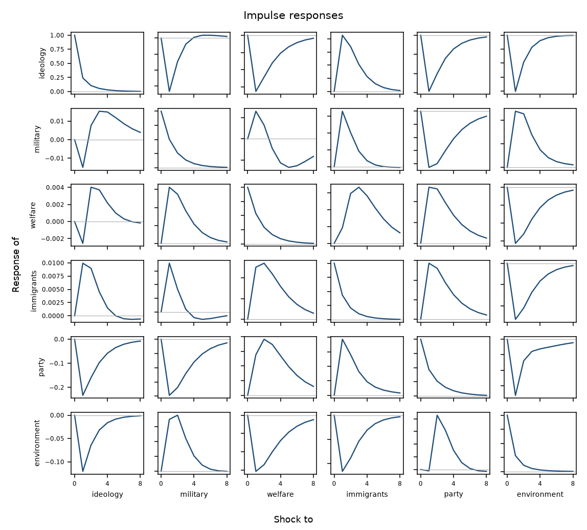

# The Nepaul-Stern Model of Attitude Stability and Constraint

This guide shows how to estimate The Nepaul-Stern Model of Attitude Stability and Constraint with the Python package `attitudedyn`. The model is for several Likert-scale attitudes measured on the same people across survey waves. Each person has a latent attitude that carries forward from one wave to the next. The recorded answer is the Likert category that latent attitude falls into.

The worked example is the General Social Survey (GSS) application. Nepaul and Stern (2026, *Political Analysis*) discuss what those estimates mean. A short account of the model is below, enough to set up the call. The R vignette *Model and estimation* is the longer technical account. The project site is <https://gabrielgggg.github.io/NepaulSternAttitudes/>.

The R guide is `vignettes/user-guide.Rmd`. `docs/attitudedyn_user_guide.pdf`, in the repository root, is that guide as a PDF.

## Install

Installing from a checkout needs a C++17 compiler and CMake. The installer compiles the shared numerical code. You do not write any C++. From the `python` directory of a checkout, or by pointing pip at it:

```bash
pip install ./python
```

Person contributions are added in person order after the cores finish, so `threads` changes the speed and not the estimates.

```python
import attitudedyn
```

## The survey file

Estimation uses a long file: one row is one person in one wave.

| Column | Role |
| --- | --- |
| `id` | Person identifier. No missing values. |
| `wave` | Wave index. No missing values. In the GSS file the indexes are 1 through 8. |
| Likert items | Integers `1, ..., K`, or missing. One column per attitude. Category 1 is the lowest category. |
| covariates | Numeric. A missing covariate is an error unless `na_action="omit"`, which drops those person-waves. Missing Likert answers stay. |
| `weight` | Optional. Zero or positive, and the same for every wave of a person. The sample log-likelihood adds up the person contributions with these weights. |

From a checkout, `attitudedyn.gss.read_gss` reads the replication file `validation/fortran/data/gss2.prn`. `OUTCOMES`, `COVARIATES`, and `TIME_GRID` are the column lists and the wave dates used below. Run this from the repository root so the path resolves.

```python
from attitudedyn.gss import COVARIATES, OUTCOMES, TIME_GRID, read_gss, read_gss_estimates

panel = read_gss("validation/fortran/data/gss2.prn")
panel.head(8)
```

```
     id  wave  weight  (Intercept)   age   hs  college  adv  female  white  black  inc_mid  inc_high  ideology  military  welfare  immigrants  party  environment
0  1001     1     1.0          1.0  23.0  0.0      1.0  0.0     1.0    0.0    1.0      0.0       1.0       6.0       NaN      NaN         NaN    1.0          NaN
1  1001     2     1.0          1.0  25.0  0.0      1.0  0.0     1.0    0.0    0.0      0.0       1.0       1.0       NaN      NaN         NaN    1.0          NaN
2  1001     3     1.0          1.0  27.0  0.0      1.0  0.0     1.0    0.0    1.0      0.0       1.0       1.0       NaN      NaN         NaN    1.0          NaN
3  1002     1     1.0          1.0  32.0  0.0      0.0  1.0     1.0    0.0    0.0      0.0       0.0       3.0       1.0      2.0         NaN    2.0          3.0
4  1002     2     1.0          1.0  34.0  0.0      0.0  1.0     1.0    0.0    0.0      0.0       1.0       4.0       2.0      2.0         3.0    1.0          3.0
5  1002     3     1.0          1.0  36.0  0.0      0.0  1.0     1.0    1.0    0.0      0.0       1.0       2.0       2.0      2.0         3.0    1.0          2.0
6  1003     1     1.0          1.0  81.0  0.0      0.0  0.0     1.0    0.0    1.0      0.0       0.0       4.0       NaN      NaN         NaN    2.0          NaN
7  1003     2     1.0          1.0  83.0  0.0      0.0  0.0     1.0    0.0    1.0      1.0       0.0       2.0       NaN      NaN         NaN    1.0          NaN
```

The Likert items are `ideology` (7 categories), `military` (3), `welfare` (3), `immigrants` (5), `party` (7), and `environment` (3). Party is stored as 0 through 6 in the text file. The reader adds 1, so the model sees 1 through 7. The covariates are an intercept, `age`, `hs`, `college`, `adv`, `female`, `white`, `black`, `inc_mid`, and `inc_high`.

The wave dates are not the calendar year of the interview. `TIME_GRID` is `2, 3, 4, 5, 6, 7, 8, 10`, in the order of wave indexes 1 through 8. The gaps are the exponents on the persistence matrix: 1, 1, 1, 1, 1, 1, 2. Every person uses this same grid. Do not pass each respondent's own interview date if you want this application.

The file has 11,282 people and 21,648 data rows. The reader returns 22,443 rows. 11,252 people have a positive weight and enter the likelihood. The other 30 are kept, with weight 0, in the order they first appear. Keep them. Dropping them changes the random draws for everyone who follows them. Among the people with positive weight, 4,769 have one row, 1,805 have two, and 4,678 have three. 809 of those rows are gaps: a wave inside a person's first-to-last window that was not in the file. The latent attitude is carried through a gap, and the gap does not add its own term to the likelihood. A missing Likert answer is different: the row was in the file, but that item was not answered. In this file the missing answers, among positive weights, number 1,503 (ideology), 11,956 (military), 12,026 (welfare), 9,652 (immigrants), 962 (party), and 11,914 (environment).

Your own survey can use the same `fit` call once it is in this shape. Code the Likert items as the integers `1, ..., K` with no skipped code. The boundary between category 1 and category 2 is fixed at zero, so the numbering is part of the model.

### How the GSS rows are filled in

The intercept is 1 on a wave that was in the file and 0 on a wave the reader inserted. Age on an inserted wave is filled from the person's first observed age of at least 16, adding two years per wave index. A category code outside `1, ..., K` is missing.

## What the model is

The Nepaul-Stern Model of Attitude Stability and Constraint gives each person an unobserved score for each attitude in each wave. That score is the latent attitude. The Likert answer is the category the score falls into.

On a wave inside the person's window, the latent attitude depends on the covariates, a shift common to that wave, a person-specific factor that does not change across waves, the latent attitudes from the previous wave, and a random shock. In the GSS specification the shocks are uncorrelated within a wave (`contemporaneous="identity"`).

### Technical detail

On a wave inside a person's window the latent attitude is

```
latent = covariate index + wave effect + factor index + lagged latent + innovation
```

The covariate index is `x beta`. Wave effects are included by default. The factor index is a loading times a standard normal person factor, constant across waves. The innovation is standard normal.

The search sees an unconstrained persistence coefficient `c`. The recursion uses

```
rho = 2 * exp(c) / (1 + exp(c)) - 1
```

which lies in (-1, 1). Each entry is raised to the gap between the wave dates, `sign(rho) * abs(rho) ** gap`, before it multiplies the lag.

An observed Likert category is an interval of the latent attitude. The cut below category 1 is -100, the cut between category 1 and category 2 is 0, and the cut above the last category is 100. Each free cut above the zero cut is the previous cut plus a positive increment. The reported coefficient is the log of that increment.

The likelihood is a simulated average over latent paths. This is a Geweke-Hajivassiliou-Keane (GHK) simulated likelihood. `draws` counts paths before the antithetic pairing. With `antithetic=True`, each draw is paired with its mirror image and the average uses `2 * draws` paths. The default generator is called Philox. It is keyed by the seed, the person, and the draw, which is why the person order matters.

## Specifying the model

Pass the Likert columns and the covariate columns, or a formula. Both describe the GSS model. The formula form accepts `` 0 + `(Intercept)` `` so the intercept column already in the data is used and a second intercept is not added. `add_intercept=False` does the same job for the column list.

```python
formula = (
    "cbind(ideology, military, welfare, immigrants, party, environment)"
    " ~ 0 + `(Intercept)` + age + hs + college + adv + female + white"
    " + black + inc_mid + inc_high"
)
```

`n_factors=2` asks for two person factors. You will not see a free intercept for each attitude. The model includes a separate shift for every wave, and the boundary between the first and second Likert categories is fixed at zero, so a free intercept would repeat those wave shifts. The intercept is held at zero (`fix_intercept=True`). Set `include_wave_effects=False` if you want free intercepts instead.

With two or more person factors, the loading of the last attitude on the last factor is held at zero (`fix_last_loading=True`). Here that is `loading[environment,f2]`.

A wave shift with no observed answers is fixed at zero. In this sample the fit warns that `wave_effect[immigrants,1]` is fixed: the immigrants item is not observed in wave 1. That coefficient is not one of the 164 free parameters.

Names on the free coefficients:

| Block | Name | What the number is |
| --- | --- | --- |
| Wave effect | `wave_effect[ideology,1]` | The shift for that attitude in that wave |
| Covariate | `beta[ideology,age]` | The slope |
| Persistence | `persistence[ideology,military]` | How the second attitude carries into the first. `result.params` prints this on the scale the search uses. `persistence_matrix()` prints it on (-1, 1). |
| Loading | `loading[ideology,f1]` | How strongly the person factor enters that attitude |
| Threshold | `threshold[ideology,3]` | The log of the gap that opens category 3. `cutpoints()` turns these into the cutpoints. |

`result.params` is the series the search moves. `fix` holds named coefficients at a value on that scale. `start` is a full set of free starting values, named or in `result.params` order.

If you omit `start`, the diagonal persistence coefficients start at the value that becomes 0.3, free loadings start at 0.5, threshold increments start at `log(0.6)`, and every other free coefficient starts at 0. The GSS fit below starts at the replication coefficients.

The cuts for this fit, including the anchors at -100, 0, and 100, are:

```
ideology: -100.000000 0.000000 1.074573 1.659211 3.061569 3.698372 4.951579 100.000000
military: -100.000000 0.000000 1.204079 100.000000
welfare: -100.000000 0.000000 1.198198 100.000000
immigrants: -100.000000 0.000000 0.765135 2.071584 2.796434 100.000000
party: -100.000000 0.000000 0.926754 1.539297 2.490246 3.036866 4.015356 100.000000
environment: -100.000000 0.000000 1.378685 100.000000
```

## Fit the General Social Survey

The call below starts from the replication estimates and evaluates them. It does not search. Run it from the repository root, after the panel has been read. On 4 cores the evaluation takes a few seconds. `start` is the 164 free coefficients in `result.params` order.

```python
estimates = read_gss_estimates("validation/fortran/src/gss_log.txt")
result = attitudedyn.fit(
    panel,
    outcomes=OUTCOMES,
    covariates=COVARIATES,
    id_col="id",
    wave_col="wave",
    time_grid=TIME_GRID,
    weights="weight",
    n_factors=2,
    draws=10,
    add_intercept=False,
    start=estimates.to_numpy(),
    threads=4,
    maxit=0,
    vcov="opg_centered",
    seed=1,
)
```

`draws=10` and `seed=1` are the defaults. Use 50 draws for a new sample. The recovery numbers behind that recommendation are under the argument table. The default of `attitudedyn.fit`, and this GSS fit, stays at 10 draws and seed 1.

| Argument | What it does | Default |
| --- | --- | --- |
| `maxit` | Steps the search may take. `0` evaluates `start` and returns. | `200` |
| `reltol` | How close two successive log-likelihoods must be before the search stops. For BFGS this is the same rule as `stats::optim`. | `1e-8` |
| `optimizer` | `"bfgs"` is the default and follows the same steps as the R package. It uses the slope of the likelihood. `"l-bfgs-b"` and `"nelder-mead"` use SciPy. `"nelder-mead"` does not use the slope. | `"bfgs"` |
| `threads` | Processor cores. The estimates do not depend on this number. | `1` |
| `seed` | Starting point of the random draws. It does not change NumPy's other random numbers. | `1` |
| `antithetic` | Pair each draw with its mirror image. | `True` |
| `draw_type` | Which random sequence to use. Leave this at `"philox"` unless you have a reason to change it. | `"philox"` |
| `vcov` | Which standard-error calculation to store. `"none"` skips it. | `"opg_centered"` |

The printed results below are the evaluation of the replication estimates, at log-likelihood -111570.9702226093. Lifting the iteration cap and searching from those coefficients took 202.6 seconds in R and 276.3 seconds in Python, both on 4 cores. Both searches stopped with convergence code 0 at log-likelihood -111545.0088160454.

`maxit=0` returns convergence code 0, so the summary says `Converged.` That means the call did what it was asked, not that a search found a maximum.

### How many draws to use

Use 50 antithetic draws for a new sample. In the recovery exercise reported in `notes/SIMULATION_RECOVERY.md`, 50 draws put the coverage of the three standard-error calculations between 0.943750 and 0.948958. One hundred draws changed the root mean squared error from 0.041987 to 0.041133 and took about twice as long.

```bash
python python/validation/run_gss.py --refit --threads 4
```

## Read the estimates

`print(result.summary())` prints a header, every free coefficient on the scale the search uses, a normal confidence interval, and the persistence matrix rounded to three decimals. The standard errors come from the calculation stored with the fit. The 10% cutoff is 1.645.

```
The Nepaul-Stern Model of Attitude Stability and Constraint
Log-likelihood: -111570.970223
People: 11252   Attitudes: 6   Waves: 8
Draws: 10 (plus antithetic twins)
Free coefficients: 164
Converged.

Coefficients (unconstrained scale):
                                         estimate    std_error  statistic        pvalue     conf_low    conf_high
wave_effect[ideology,1]                   2.19414    0.0537641    40.8105             0      2.08877      2.29952
wave_effect[ideology,2]                   2.07446    0.0524552    39.5473             0      1.97165      2.17727
wave_effect[ideology,3]                   2.02742    0.0529011    38.3247             0      1.92373       2.1311
wave_effect[ideology,4]                   1.92311    0.0595047    32.3185  3.84003e-229      1.80648      2.03973
wave_effect[ideology,5]                   1.82646     0.065509     27.881  4.53409e-171      1.69806      1.95485
wave_effect[ideology,6]                   2.08615    0.0528405    39.4802             0      1.98259      2.18972
wave_effect[ideology,7]                   2.06609    0.0533493    38.7276             0      1.96153      2.17065
wave_effect[ideology,8]                   2.05663    0.0523856    39.2595             0      1.95396      2.15931
wave_effect[military,1]                 -0.288975    0.0689926   -4.18849   2.80814e-05    -0.424198    -0.153752
wave_effect[military,2]                 -0.433582    0.0676748   -6.40685   1.48553e-10    -0.566223    -0.300942
wave_effect[military,3]                 -0.231915    0.0670159    -3.4606   0.000538964    -0.363264    -0.100567
wave_effect[military,4]                 -0.348256     0.077269   -4.50707   6.57298e-06    -0.499701    -0.196812
wave_effect[military,5]                 -0.169827    0.0834813   -2.03431     0.0419201    -0.333447  -0.00620669
wave_effect[military,6]                 0.0910581      0.06645    1.37033      0.170585   -0.0391815     0.221298
wave_effect[military,7]                -0.0163355     0.069297  -0.235732      0.813641    -0.152155     0.119484
wave_effect[military,8]                 -0.206867    0.0712802   -2.90216    0.00370594    -0.346574   -0.0671602
wave_effect[welfare,1]                   0.763097    0.0728907    10.4691   1.19821e-25     0.620234     0.905961
wave_effect[welfare,2]                   0.741931     0.070024    10.5954   3.13039e-26     0.604687     0.879176
wave_effect[welfare,3]                   0.619622     0.071069     8.7186   2.81667e-18     0.480329     0.758914
wave_effect[welfare,4]                   0.500512    0.0817232    6.12448   9.09812e-10     0.340338     0.660687
wave_effect[welfare,5]                   0.560939    0.0921999    6.08394   1.17264e-09      0.38023     0.741647
wave_effect[welfare,6]                   0.603802    0.0703441    8.58355   9.19875e-18      0.46593     0.741674
wave_effect[welfare,7]                   0.741719    0.0727465    10.1959   2.06714e-24     0.599139       0.8843
wave_effect[welfare,8]                   0.693559    0.0751544    9.22845   2.74567e-20     0.546259     0.840859
wave_effect[immigrants,2]                 1.29178    0.0563771    22.9133  3.42726e-116      1.18129      1.40228
wave_effect[immigrants,3]                 1.14817    0.0494667    23.2109  3.53751e-119      1.05121      1.24512
wave_effect[immigrants,4]                 1.03105    0.0545704    18.8939   1.28048e-79     0.924092        1.138
wave_effect[immigrants,5]                 1.11239    0.0629917    17.6592   8.63937e-70     0.988924      1.23585
wave_effect[immigrants,6]                   1.499    0.0530972    28.2312  2.42463e-175      1.39493      1.60306
wave_effect[immigrants,7]                 1.67488    0.0545736    30.6902  7.68247e-207      1.56791      1.78184
wave_effect[immigrants,8]                 1.19314    0.0594779    20.0603   1.64091e-89      1.07657      1.30972
wave_effect[party,1]                      1.78479    0.0635696    28.0762  1.91384e-173       1.6602      1.90939
wave_effect[party,2]                      1.49033    0.0614461    24.2542  5.97135e-130      1.36989      1.61076
wave_effect[party,3]                       1.4837    0.0628667    23.6007  3.78959e-123      1.36048      1.60692
wave_effect[party,4]                      1.38228    0.0703357    19.6526   5.48859e-86      1.24443      1.52014
wave_effect[party,5]                      1.35877    0.0769386    17.6604   8.45703e-70      1.20797      1.50957
wave_effect[party,6]                       1.6026    0.0633102    25.3134  2.27296e-141      1.47851      1.72668
wave_effect[party,7]                      1.66478    0.0641175    25.9645   1.2458e-148      1.53911      1.79045
wave_effect[party,8]                      1.57891    0.0627785    25.1505  1.39428e-139      1.45587      1.70196
wave_effect[environment,1]                2.09567    0.0835807    25.0736  9.65568e-139      1.93185      2.25948
wave_effect[environment,2]                 1.9747    0.0789305    25.0182  3.87521e-138         1.82       2.1294
wave_effect[environment,3]                1.67623     0.079143    21.1798   1.46783e-99      1.52111      1.83135
wave_effect[environment,4]                1.76403    0.0892055    19.7749   4.89688e-87      1.58919      1.93887
wave_effect[environment,5]                1.89178     0.100979    18.7343   2.59984e-78      1.69386       2.0897
wave_effect[environment,6]                1.89137    0.0800032    23.6412  1.45383e-123      1.73457      2.04818
wave_effect[environment,7]                2.08761     0.082542    25.2915   3.9601e-141      1.92583      2.24939
wave_effect[environment,8]                2.27865    0.0880092     25.891  8.40691e-148      2.10615      2.45114
beta[ideology,age]                     0.00890575   0.00053418    16.6718   2.10108e-62   0.00785878   0.00995272
beta[ideology,hs]                       0.0389436    0.0279587    1.39289      0.163652   -0.0158545    0.0937416
beta[ideology,college]                  -0.131787    0.0330858   -3.98318   6.79999e-05    -0.196634   -0.0669396
beta[ideology,adv]                      -0.436425    0.0371282   -11.7545   6.69299e-32    -0.509195    -0.363655
beta[ideology,female]                   -0.112073    0.0177608   -6.31016   2.78749e-10    -0.146884   -0.0772628
beta[ideology,white]                    0.0347212    0.0322873    1.07539      0.282202   -0.0285606    0.0980031
beta[ideology,black]                    -0.150774    0.0385956   -3.90651   9.36399e-05     -0.22642    -0.075128
beta[ideology,inc_mid]                  0.0487865    0.0281083    1.73566     0.0826233   -0.0063047     0.103878
beta[ideology,inc_high]                 0.0718818    0.0198514    3.62099   0.000293478    0.0329737      0.11079
beta[military,age]                      0.0101607  0.000676522     15.019   5.51556e-51    0.0088347    0.0114866
beta[military,hs]                       0.0289969    0.0380864   0.761346       0.44645    -0.045651     0.103645
beta[military,college]                  -0.302258    0.0446899   -6.76345   1.34745e-11    -0.389848    -0.214667
beta[military,adv]                      -0.489257    0.0503311   -9.72077   2.45921e-22    -0.587905     -0.39061
beta[military,female]                    0.143222    0.0228363    6.27169    3.5716e-10    0.0984639     0.187981
beta[military,white]                     0.239719    0.0410202    5.84394   5.09799e-09     0.159321     0.320117
beta[military,black]                    0.0954955    0.0488587    1.95452     0.0506393 -0.000265789     0.191257
beta[military,inc_mid]                 -0.0569046    0.0409789   -1.38863      0.164945    -0.137222    0.0234126
beta[military,inc_high]                 0.0578839    0.0274156    2.11135     0.0347425   0.00415024     0.111617
beta[welfare,age]                     -0.00115952  0.000706948   -1.64018      0.100968  -0.00254511  0.000226073
beta[welfare,hs]                        -0.134834    0.0395273   -3.41115   0.000646885    -0.212306   -0.0573616
beta[welfare,college]                 -0.00233773    0.0471708 -0.0495588      0.960474   -0.0947908    0.0901153
beta[welfare,adv]                        0.139973    0.0531799    2.63206    0.00848693    0.0357419     0.244203
beta[welfare,female]                    0.0380378    0.0240004    1.58488      0.112994  -0.00900221    0.0850777
beta[welfare,white]                     -0.143483    0.0443823   -3.23287    0.00122551     -0.23047   -0.0564948
beta[welfare,black]                      0.260471      0.05229    4.98128   6.31655e-07     0.157985     0.362958
beta[welfare,inc_mid]                  -0.0171697    0.0425877  -0.403162      0.686829     -0.10064    0.0663006
beta[welfare,inc_high]                  -0.304853    0.0286805   -10.6293   2.17803e-26    -0.361066    -0.248641
beta[immigrants,age]                  -0.00587847  0.000545535   -10.7756    4.4884e-27   -0.0069477  -0.00480924
beta[immigrants,hs]                    -0.0309034    0.0283839   -1.08876      0.276258   -0.0865347     0.024728
beta[immigrants,college]                 0.313761    0.0344473    9.10841   8.35949e-20     0.246245     0.381276
beta[immigrants,adv]                     0.458367    0.0399446    11.4751   1.76041e-30     0.380077     0.536657
beta[immigrants,female]                 0.0185234    0.0185384   0.999194      0.317701   -0.0178111    0.0548579
beta[immigrants,white]                  -0.386179    0.0359207   -10.7509   5.86954e-27    -0.456583    -0.315776
beta[immigrants,black]                   -0.10634    0.0415327    -2.5604     0.0104551    -0.187743   -0.0249378
beta[immigrants,inc_mid]               -0.0431484    0.0347252   -1.24257      0.214027    -0.111209    0.0249118
beta[immigrants,inc_high]              0.00414564    0.0227025   0.182607      0.855106   -0.0403504    0.0486417
beta[party,age]                        0.00172248    0.0006138    2.80626    0.00501197  0.000519459   0.00292551
beta[party,hs]                          0.0938045     0.032687    2.86978    0.00410758    0.0297392      0.15787
beta[party,college]                     0.0330299    0.0383447   0.861393      0.389022   -0.0421244     0.108184
beta[party,adv]                         -0.325031    0.0423939   -7.66691   1.76183e-14    -0.408121     -0.24194
beta[party,female]                       -0.20524    0.0205524   -9.98615   1.75264e-23    -0.245522    -0.164958
beta[party,white]                        0.321413    0.0382564    8.40155    4.4064e-17     0.246432     0.396394
beta[party,black]                        -0.80776    0.0471898   -17.1173   1.10326e-65     -0.90025     -0.71527
beta[party,inc_mid]                    -0.0809915    0.0319099   -2.53813     0.0111446    -0.143534   -0.0184493
beta[party,inc_high]                    0.0276228    0.0222733    1.24018      0.214909    -0.016032    0.0712777
beta[environment,age]                  -0.0119296  0.000817478   -14.5932   3.10173e-48   -0.0135319   -0.0103274
beta[environment,hs]                     0.121307    0.0438863    2.76412    0.00570766    0.0352914     0.207322
beta[environment,college]                0.261763    0.0528494      4.953   7.30774e-07      0.15818     0.365346
beta[environment,adv]                    0.374627    0.0597782    6.26694   3.68215e-10     0.257463      0.49179
beta[environment,female]                 0.169284    0.0264715    6.39493   1.60617e-10       0.1174     0.221167
beta[environment,white]                  0.135097     0.049169     2.7476    0.00600336    0.0387272     0.231466
beta[environment,black]                  0.188547    0.0600911    3.13769    0.00170286    0.0707708     0.306324
beta[environment,inc_mid]               0.0368881    0.0481087   0.766767       0.44322   -0.0574031     0.131179
beta[environment,inc_high]              0.0612614    0.0330392     1.8542     0.0637101  -0.00349425     0.126017
persistence[ideology,ideology]           0.492982    0.0199398    24.7235  5.97649e-135     0.453901     0.532064
persistence[ideology,military]         -0.0670045    0.0319538   -2.09692     0.0360007    -0.129633  -0.00437624
persistence[ideology,welfare]          -0.0653064    0.0313714   -2.08172      0.037368    -0.126793  -0.00381967
persistence[ideology,immigrants]        0.0856246     0.028425     3.0123    0.00259278    0.0299126     0.141337
persistence[ideology,party]             -0.295046    0.0186786   -15.7959   3.31829e-56    -0.331656    -0.258437
persistence[ideology,environment]       -0.202337     0.024313   -8.32218   8.63591e-17     -0.24999    -0.154684
persistence[military,ideology]         -0.0299188    0.0302248  -0.989875      0.322235   -0.0891583    0.0293208
persistence[military,military]             1.1077    0.0453443    24.4286    8.493e-132      1.01883      1.19657
persistence[military,welfare]          0.00524414    0.0376714   0.139208      0.889286   -0.0685904    0.0790787
persistence[military,immigrants]        0.0330585    0.0418609   0.789724      0.429689   -0.0489872     0.115104
persistence[military,party]              -0.17232    0.0299407   -5.75539    8.6444e-09    -0.231003    -0.113638
persistence[military,environment]       0.0238193    0.0312941   0.761143      0.446572    -0.037516    0.0851545
persistence[welfare,ideology]         -0.00512173    0.0306405  -0.167156      0.867247   -0.0651759    0.0549325
persistence[welfare,military]           0.0625967    0.0403353    1.55191      0.120684    -0.016459     0.141652
persistence[welfare,welfare]              1.19794     0.051411    23.3012  4.30765e-120      1.09718       1.2987
persistence[welfare,immigrants]         0.0186753    0.0451096   0.413999      0.678875   -0.0697378     0.107088
persistence[welfare,party]               0.107065    0.0300477    3.56317   0.000366403    0.0481727     0.165957
persistence[welfare,environment]        -0.315812    0.0337594   -9.35477   8.37845e-21    -0.381979    -0.249644
persistence[immigrants,ideology]        0.0198812    0.0243968   0.814907      0.415125   -0.0279358    0.0676981
persistence[immigrants,military]        0.0178309    0.0391905    0.45498      0.649124   -0.0589811    0.0946429
persistence[immigrants,welfare]          0.100859    0.0370961    2.71886    0.00655079     0.028152     0.173566
persistence[immigrants,immigrants]       0.930059    0.0319868    29.0763  7.15001e-186     0.867366     0.992752
persistence[immigrants,party]             0.11481    0.0229413     5.0045   5.60078e-07    0.0698455     0.159774
persistence[immigrants,environment]     -0.265577    0.0290634   -9.13783   6.37155e-20     -0.32254    -0.208613
persistence[party,ideology]             -0.474864    0.0227951   -20.8319   2.22541e-96    -0.519542    -0.430187
persistence[party,military]             -0.158044    0.0388624   -4.06675   4.76741e-05    -0.234213   -0.0818747
persistence[party,welfare]              0.0554088    0.0371306    1.49227      0.135629   -0.0173658     0.128183
persistence[party,immigrants]           0.0772782    0.0325446    2.37453     0.0175711     0.013492     0.141064
persistence[party,party]                  1.01346    0.0295038    34.3503  1.39552e-258     0.955636      1.07129
persistence[party,environment]         -0.0722021    0.0272564   -2.64899    0.00807316    -0.125624   -0.0187805
persistence[environment,ideology]       -0.242009    0.0327189   -7.39662    1.3969e-13    -0.306137    -0.177881
persistence[environment,military]       0.0139213    0.0425888   0.326878       0.74376   -0.0695511    0.0973938
persistence[environment,welfare]        -0.061201    0.0437958   -1.39742      0.162288    -0.147039    0.0246372
persistence[environment,immigrants]     -0.233603    0.0457812   -5.10259   3.35044e-07    -0.323332    -0.143873
persistence[environment,party]       -0.000428535    0.0302619 -0.0141609      0.988702   -0.0597407    0.0588837
persistence[environment,environment]     0.578393    0.0419667    13.7822   3.26183e-43      0.49614     0.660646
loading[ideology,f1]                     0.729507    0.0144984    50.3163             0     0.701091     0.757924
loading[military,f1]                     0.395218    0.0178927    22.0882  4.10513e-108     0.360149     0.430287
loading[welfare,f1]                      -0.54423    0.0221741   -24.5435  5.07156e-133     -0.58769    -0.500769
loading[immigrants,f1]                  -0.351662    0.0172755   -20.3561   4.10339e-92    -0.385521    -0.317802
loading[party,f1]                        0.898242    0.0162758    55.1887             0     0.866342     0.930142
loading[environment,f1]                 -0.713667    0.0257463   -27.7192  4.09726e-169    -0.764129    -0.663205
loading[ideology,f2]                     0.695422    0.0142327     48.861             0     0.667526     0.723317
loading[military,f2]                     0.316526    0.0180866    17.5006   1.41673e-68     0.281077     0.351975
loading[welfare,f2]                      -0.13461    0.0185757   -7.24655   4.27537e-13    -0.171017    -0.098202
loading[immigrants,f2]                  -0.164181    0.0155555   -10.5546    4.8395e-26     -0.19467    -0.133693
loading[party,f2]                        0.934497    0.0180439    51.7903             0     0.899132     0.969862
threshold[ideology,3]                   0.0719237    0.0151398    4.75063   2.02783e-06    0.0422502     0.101597
threshold[ideology,4]                   -0.536762    0.0175651   -30.5584  4.37463e-205    -0.571189    -0.502335
threshold[ideology,5]                    0.338155   0.00942645     35.873  8.05515e-282      0.31968     0.356631
threshold[ideology,6]                   -0.451296    0.0162089   -27.8425  1.32816e-170    -0.483065    -0.419527
threshold[ideology,7]                    0.225707    0.0135017    16.7168   9.88257e-63     0.199244     0.252169
threshold[military,3]                    0.185715    0.0132427    14.0239   1.11321e-44      0.15976      0.21167
threshold[welfare,3]                     0.180818    0.0137308    13.1688   1.32733e-39     0.153906      0.20773
threshold[immigrants,3]                 -0.267703     0.015724   -17.0252   5.34302e-65    -0.298522    -0.236885
threshold[immigrants,4]                  0.267313    0.0116404    22.9642  1.06236e-116     0.244498     0.290128
threshold[immigrants,5]                  -0.32179    0.0239329   -13.4455   3.27257e-41    -0.368697    -0.274882
threshold[party,3]                     -0.0760676    0.0140251   -5.42367   5.83878e-08    -0.103556   -0.0485789
threshold[party,4]                      -0.490135    0.0163357    -30.004  8.70806e-198    -0.522152    -0.458117
threshold[party,5]                     -0.0502956    0.0131204    -3.8334   0.000126382    -0.076011   -0.0245802
threshold[party,6]                      -0.604002    0.0187373   -32.2352  5.66359e-228    -0.640726    -0.567277
threshold[party,7]                     -0.0217444    0.0154967   -1.40317      0.160568   -0.0521174   0.00862854
threshold[environment,3]                  0.32113    0.0165431    19.4117   6.14138e-84     0.288706     0.353554

Signif. codes use the normal distribution. The 10% cutoff is 1.645.

Persistence on (-1, 1), receiving attitude by source attitude:
             ideology  military  welfare  immigrants  party  environment
ideology        0.242    -0.033   -0.033       0.043 -0.146       -0.101
military       -0.015     0.503    0.003       0.017 -0.086        0.012
welfare        -0.003     0.031    0.536       0.009  0.053       -0.157
immigrants      0.010     0.009    0.050       0.434  0.057       -0.132
party          -0.233    -0.079    0.028       0.039  0.467       -0.036
environment    -0.120     0.007   -0.031      -0.116 -0.000        0.281

Covariance type: opg_centered
```

Read the header first. It is the sample log-likelihood, the number of people with positive weight, the number of attitudes and waves, the draw count, the number of free coefficients, and whether the call converged. There are 164 free coefficients. `wave_effect[immigrants,1]` is absent because it was held at zero. `result.to_dataframe()` is the same coefficient table as a data frame. The first rows are the ideology wave shifts.

```
                         estimate  std_error  statistic         pvalue  conf_low  conf_high
wave_effect[ideology,1]  2.194142   0.053764  40.810547   0.000000e+00  2.088767   2.299518
wave_effect[ideology,2]  2.074462   0.052455  39.547281   0.000000e+00  1.971652   2.177272
wave_effect[ideology,3]  2.027419   0.052901  38.324673   0.000000e+00  1.923735   2.131104
wave_effect[ideology,4]  1.923106   0.059505  32.318543  3.840033e-229  1.806479   2.039733
wave_effect[ideology,5]  1.826457   0.065509  27.881012  4.534093e-171  1.698062   1.954852
wave_effect[ideology,6]  2.086153   0.052841  39.480177   0.000000e+00  1.982588   2.189719
wave_effect[ideology,7]  2.066090   0.053349  38.727628   0.000000e+00  1.961527   2.170653
wave_effect[ideology,8]  2.056632   0.052386  39.259489   0.000000e+00  1.953958   2.159306
```

`result.params`, `result.bse`, and `result.pvalues` are named Series. `result.loglik`, `result.aic`, `result.bic`, and `result.nobs` are the fit statistics in the header.

## Where the standard errors come from

`summary()` uses the covariance stored on the fit. The default, `opg_centered`, looks at how each person's contribution to the slope of the likelihood varies, subtracts the average, and inverts the result. `result.vcov()` returns that matrix.

`result.vcov(type="opg")` skips the subtraction. `type="hessian"` uses the curvature of the likelihood. `type="sandwich"` combines the curvature with the variation in the person contributions. `result.summary(vcov_type="sandwich")` reprints the table with the calculation you name.

### Technical detail

`opg_centered` centres the person scores and inverts their outer product. `opg` is that inverse without the centring. `hessian` inverts the negative numerical Hessian of the analytic gradient. `sandwich` is that inverse, times the uncentred outer product of the scores, times the inverse. `hessian` and `sandwich` difference the slope once per free coefficient, so on the GSS sample they cost much more than `opg_centered`. Set `vcov="none"` during a trial search.

The corner of the stored `opg_centered` matrix is:

```
                         wave_effect[ideology,1]  wave_effect[ideology,2]  wave_effect[ideology,3]
wave_effect[ideology,1]                 0.002891                 0.002241                 0.002252
wave_effect[ideology,2]                 0.002241                 0.002752                 0.002404
wave_effect[ideology,3]                 0.002252                 0.002404                 0.002799
```

## Persistence, shocks, and variance shares

`persistence_matrix()` is the scale you interpret, from -1 to 1. The row is the attitude that receives the carry-over. The column is the earlier attitude. The entry is the coefficient before it is raised to the gap between waves.

```
             ideology  military   welfare  immigrants     party  environment
ideology     0.241617 -0.033490 -0.032642    0.042786 -0.146462    -0.100825
military    -0.014958  0.503400  0.002622    0.016528 -0.085948     0.011909
welfare     -0.002561  0.031288  0.536316    0.009337  0.053481    -0.156606
immigrants   0.009940  0.008915  0.050387    0.434175  0.057342    -0.132013
party       -0.233069 -0.078858  0.027697    0.038620  0.467394    -0.036085
environment -0.120417  0.006961 -0.030591   -0.116273 -0.000214     0.281395
```

`impulse_response(horizon=8)` traces a one-time shock. Horizon 0 is the moment of the shock. Later rows are the response after that many steps of one time unit. The spectral radius for this fit is 0.6366776792122704, which is below 1, so the shock dies out. `to_dataframe()` is one row per horizon, receiving attitude, and source attitude. The ideology responses at horizons 0 and 1 are:

```python
irf = result.impulse_response(horizon=8)
irf.spectral_radius
irf.to_dataframe().query("horizon <= 1 and to == 'ideology'")
```

```
 horizon       to        from  response
       0 ideology    ideology  1.000000
       0 ideology    military  0.000000
       0 ideology     welfare  0.000000
       0 ideology  immigrants  0.000000
       0 ideology       party  0.000000
       0 ideology environment  0.000000
       1 ideology    ideology  0.241617
       1 ideology    military -0.033490
       1 ideology     welfare -0.032642
       1 ideology  immigrants  0.042786
       1 ideology       party -0.146462
       1 ideology environment -0.100825
```

In the figure, each row is the attitude that responds and each column is the attitude that was shocked. Horizon 0 is the moment of the shock.

### Technical detail

`impulse_response()` raises the persistence matrix to successive powers. The array is `response[horizon, to, from]`. Horizon 0 is the identity. `spectral_radius` is the radius of that matrix.



`variance_decomposition()` splits each latent attitude into four pieces. `covariate` is the part coming from the covariates and the wave shifts together. `wave_effect` is the wave shift on its own. `factor` is the person-specific factor. `shock` is the part coming from the random shocks, carried forward by persistence. `total` adds the four.

### Technical detail

`covariate` is the variance of the wave effect plus the covariate index. `wave_effect` is the variance of the wave effect on its own. `factor` is the sum of squared loadings. `shock` is the average, over people in the likelihood, of the finite-horizon contribution built from the gap-scaled persistence coefficients. `total` adds the four.

```python
result.variance_decomposition()
```

```
   attitude  covariate  wave_effect   factor    shock    total
   ideology   0.055398     0.006744 1.015792 1.075184 2.153119
   military   0.080662     0.012031 0.256386 1.230515 1.579594
    welfare   0.067683     0.008043 0.314306 1.281257 1.671288
 immigrants   0.115663     0.025941 0.150622 1.180127 1.472352
      party   0.152489     0.008187 1.680123 1.241410 3.082209
environment   0.088227     0.044159 0.509320 1.087319 1.729025
```

## Predicted answers and new panels

`predict()` averages paths at the fitted coefficients. These paths are not the random draws used in the likelihood. `type="prob"` returns one row per person, wave, attitude, and Likert category. `type="class"` returns the category with the largest probability. `type="latent"` returns the average latent attitude before the shock is added. `n_draws` defaults to `max(20, result.draws)`. The seed defaults to the fit seed plus one.

```python
result.predict(type="class", n_draws=2, seed=2).head(8)
result.predict(type="prob", n_draws=2, seed=2).query("attitude == 'ideology'").head(6)
```

```
  id  wave  ideology  military  welfare  immigrants  party  environment
1001     1         4         1        2           1      1            3
1001     2         4         1        1           3      1            3
1001     3         4         1        1           3      1            3
1002     1         2         1        3           3      1            3
1002     2         2         1        3           3      1            3
1002     3         4         1        2           3      1            3
1003     1         4         2        3           1      1            3
1003     2         4         2        3           1      1            3
```

```
  id  wave attitude  category  probability
1001     1 ideology         1     0.027580
1001     1 ideology         2     0.127237
1001     1 ideology         3     0.127259
1001     1 ideology         4     0.364818
1001     1 ideology         5     0.151856
1001     1 ideology         6     0.170565
```

`simulate()` draws a new panel from the fitted coefficients. It does not resample the GSS rows. Covariates other than the intercept are standard normal draws, so the panel is a check of the fitted model, not a copy of the survey. The intercept column is omitted so the frame can be passed back to `fit` with `add_intercept=True`. The wave dates are the grid stored with the fit. The size is the estimation sample, 11,252 people and 8 waves (90,016 rows). The seed defaults to the fit seed plus 17. `nsim` greater than 1 returns a list of frames.

```python
result.simulate(nsim=1, seed=2).head(4)
```

```
 id  wave  time       age        hs   college       adv    female     white     black   inc_mid  inc_high  ideology  military  welfare  immigrants  party  environment
  1     1   2.0 -0.902649  0.509038  0.230176  1.203526 -1.075792  1.407368  0.824571  1.318850  0.087659         4         1        3           1      3            3
  1     2   3.0  0.493890  0.635690  1.404279  0.577871 -0.570343 -0.636241 -0.727870  0.710408 -0.424382         4         1        2           5      2            3
  1     3   4.0  1.172156  0.047874 -1.506860  0.023616 -1.064688 -0.773162  0.728826  1.481969 -1.145354         4         1        3           2      1            2
  1     4   5.0 -1.112672 -0.079666 -0.285697 -1.334212 -0.548818 -1.374384 -0.875652 -1.338235  0.862570         4         1        3           3      2            2
```

## Save the estimates

`pickle` cannot store the fitted object, because it holds internal compiled state. Save the coefficient series and evaluate it again with `maxit=0`. Reloading the series from this fit and evaluating it reproduced the log-likelihood -111570.9702226093, and the largest absolute difference between the two coefficient vectors was 0.

```python
result.params.to_pickle("gss_params.pkl")
start = pd.read_pickle("gss_params.pkl")
again = attitudedyn.fit(
    panel,
    outcomes=OUTCOMES,
    covariates=COVARIATES,
    id_col="id",
    wave_col="wave",
    time_grid=TIME_GRID,
    weights="weight",
    n_factors=2,
    draws=10,
    add_intercept=False,
    start=start.to_numpy(),
    threads=4,
    maxit=0,
    vcov="none",
    seed=1,
)
again.loglik
```

## If something goes wrong

**The search did not finish.** `result.convergence` is 0 when the search reports success, and `summary()` then says `Converged.` A positive code is the search status. A code of 1 means the search hit the iteration cap. Fit again from `start=result.params` with a larger `maxit`. `maxit=0` is not a failed search. It returns code 0 because it was asked only to evaluate the start.

**The run is slow.** Almost all of the time is the simulated likelihood. One evaluation of the GSS sample, at 10 draws and 4 cores, takes a few seconds, and the search quoted above took 276.3 seconds in Python. The cost moves about in proportion to `draws`. The curvature standard errors (`hessian` and `sandwich`) cost much more than `opg_centered` on this sample. Set `vcov="none"` on a trial search. `trace=True` prints the log-likelihood at the start.

**Cores.** `threads` splits the people across cores. The default is 1. Set it to the number of cores you want to use. Person contributions are added afterwards in person order, so the log-likelihood and its slope do not change with the number of cores.

### The same seed on another computer

The draws are Philox values keyed by the seed, the person index, and the draw. They do not use NumPy's random-number generator, and they do not depend on which core evaluates a person. The same person order produces the same draws on every computer. For the GSS file, keep every person the reader returned, including the weight-0 rows, in that order. The summed log-likelihood can still move by less than `1e-9` when `exp`, `log`, or the normal tail differs across computers. That is a different math library, not a different seed and not a different core count.

## Further reading

The R vignette *Model and estimation* writes the recursion, the cuts, the simulated likelihood, and the four standard-error calculations. The vignette *Replicating the GSS application* is the map from the replication file to this sample. Nepaul and Stern (2026) discuss the GSS estimates. In R, `citation("attitudedyn")` prints the paper and the replication package. The project site is <https://gabrielgggg.github.io/NepaulSternAttitudes/>.
